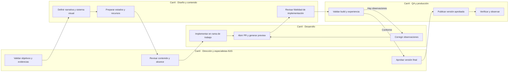
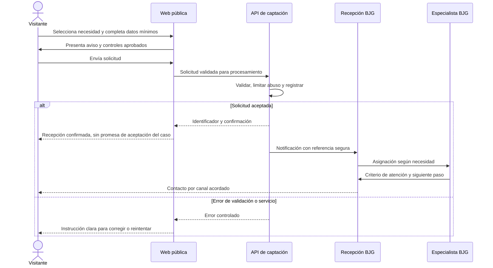
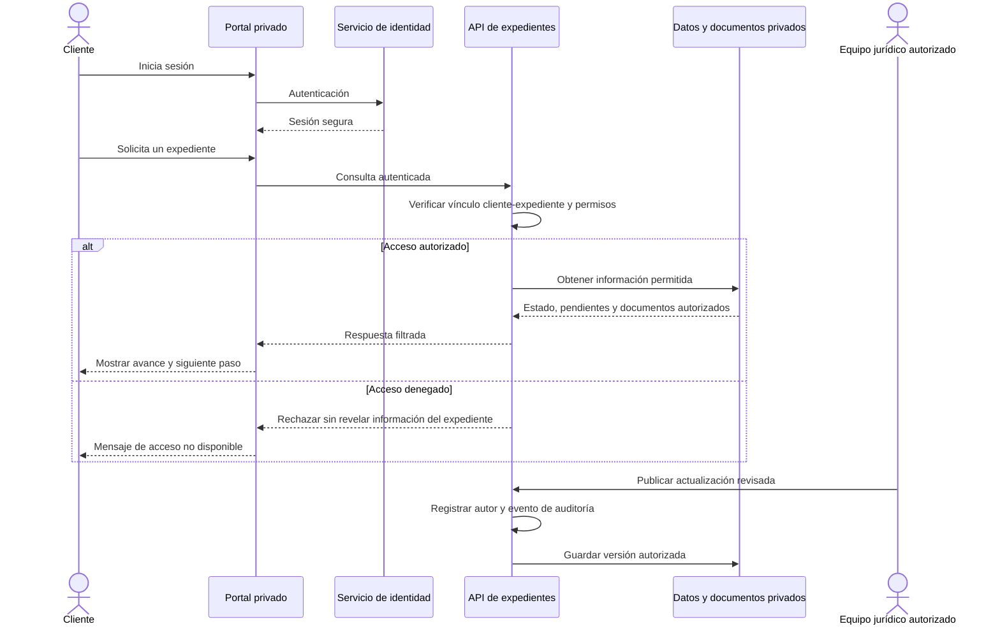
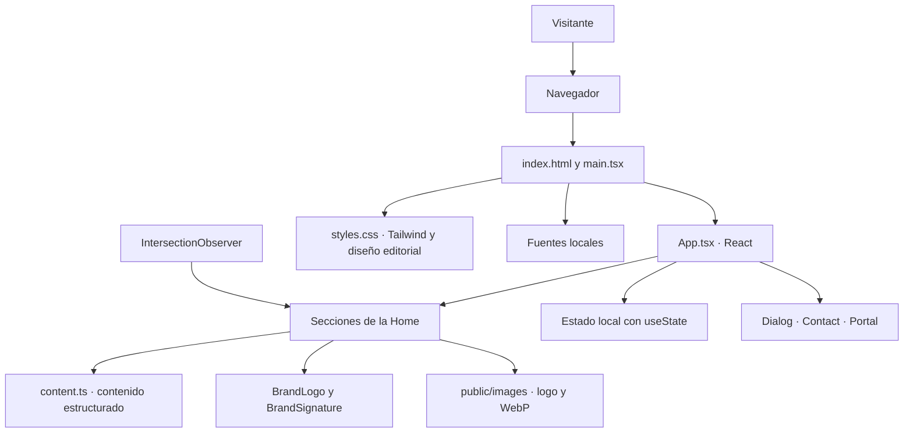
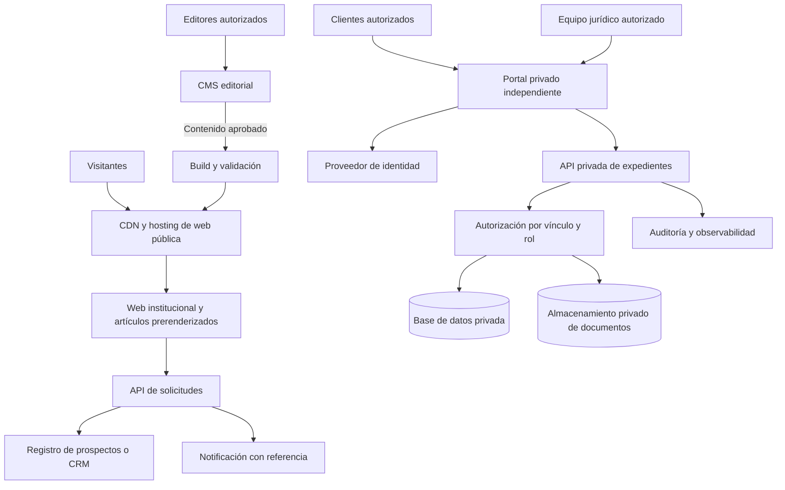

# BJG México · Inteligencia Jurídica en Acción

**Bufete Jurídico Guadarrama · Estrategia · Protección · Ejecución**

Plataforma institucional de BJG México, concebida como la marca madre de la firma y como una experiencia digital de alta fidelidad para comunicar trayectoria, criterio colegiado, especialización y capacidad de ejecución.

Este repositorio será el punto de trabajo compartido entre **diseño, contenido, desarrollo y producción**, con validación institucional de BJG y dirección creativa de Vector Inside.

> **Estado al 23 de octubre de 2026:** existe un prototipo funcional local en React, TypeScript, Vite y Tailwind CSS. Al preparar este README, el repositorio remoto estaba vacío. Este documento inicia la documentación; no implica que el código, los recursos gráficos o las integraciones descritas ya estén publicados en GitHub.
>
> **Alcance actual:** interfaz demostrativa. El formulario no envía ni almacena datos. El seguimiento no consulta expedientes reales. No existen autenticación, backend ni portal operativo.

## Contenido

- [1. Visión y objetivos](#1-visión-y-objetivos)
- [2. Alcance y estado](#2-alcance-y-estado)
- [3. Narrativa y reglas editoriales](#3-narrativa-y-reglas-editoriales)
- [4. Experiencia y estructura de la Home](#4-experiencia-y-estructura-de-la-home)
- [5. Sistema visual y movimiento](#5-sistema-visual-y-movimiento)
- [6. Usuarios y responsabilidades](#6-usuarios-y-responsabilidades)
- [7. Diagramas de carriles](#7-diagramas-de-carriles)
- [8. Arquitectura implementada localmente](#8-arquitectura-implementada-localmente)
- [9. Arquitectura propuesta para producción](#9-arquitectura-propuesta-para-producción)
- [10. Dependencias y herramientas](#10-dependencias-y-herramientas)
- [11. Instalación y ejecución](#11-instalación-y-ejecución)
- [12. Organización del código](#12-organización-del-código)
- [13. Contratos y modelo de datos propuestos](#13-contratos-y-modelo-de-datos-propuestos)
- [14. Seguridad, privacidad y accesibilidad](#14-seguridad-privacidad-y-accesibilidad)
- [15. Flujo de colaboración](#15-flujo-de-colaboración)
- [16. Calidad y criterios de aceptación](#16-calidad-y-criterios-de-aceptación)
- [17. Entornos y despliegue](#17-entornos-y-despliegue)
- [18. Hoja de ruta](#18-hoja-de-ruta)
- [19. Pendientes de contenido y decisiones](#19-pendientes-de-contenido-y-decisiones)
- [20. Documentación complementaria y derechos](#20-documentación-complementaria-y-derechos)

## 1. Visión y objetivos

La nueva web debe ayudar a una persona o empresa a entender **qué necesita proteger, cómo piensa BJG y cuál es el siguiente paso** para iniciar una conversación con la firma.

El posicionamiento se sostiene en:

| Pilar | Significado | Expresión en la experiencia |
| --- | --- | --- |
| Estrategia | Comprender el contexto y contrastar alternativas antes de actuar | Método BJG, criterio colegiado y decisiones explicadas |
| Protección | Identificar riesgos y preservar los intereses del cliente | Rutas de prevención, patrimonio y continuidad |
| Ejecución | Convertir el diagnóstico en una ruta concreta | Acciones, responsables y seguimiento comprensible |

### Objetivos del proyecto

1. Presentar a BJG México como una firma jurídica premium con identidad propia.
2. Dar presencia al legado desde 1979 y a los resultados comunicados por la firma.
3. Explicar el trabajo colegiado y la honestidad radical con lenguaje claro.
4. Organizar la oferta por necesidades del cliente, antes que por tecnicismos jurídicos.
5. Facilitar el contacto y el acceso futuro a un seguimiento verificable.
6. Proporcionar una base mantenible para contenido editorial e integraciones posteriores.

### Relación con BJG USA

BJG México comunica la profundidad institucional de la firma. BJG USA atiende la narrativa de personas que viven en Estados Unidos y requieren servicios jurídicos **en México**. No debe inferirse habilitación para ejercer derecho estadounidense ni representación en esa jurisdicción sin validación expresa.

El desarrollo de México es independiente: **no modificar la carpeta, configuración ni despliegue de BJG USA** para trabajar en este proyecto.

## 2. Alcance y estado

En este documento, **implementado** significa presente en el prototipo local inspeccionado. **Propuesto** identifica una decisión de arquitectura o un trabajo futuro, todavía sin implementar.

| Capacidad | Estado | Observaciones |
| --- | --- | --- |
| Home editorial completa | Implementado localmente | Secciones originales y nuevos bloques de autoridad |
| Menú sticky y navegación móvil | Implementado localmente | Anclas internas y CTA persistente móvil |
| Método BJG interactivo | Implementado localmente | Seis pasos, selección y avance |
| Rutas por necesidad | Implementado localmente | Proteger, Prevenir, Resolver, Estructurar |
| Logo con g dorada | Implementado localmente | Capas CSS sobre el recurso original |
| Animación del emblema | Implementado localmente | Entrada, anillos, luz y botón para repetir |
| Casos, perfiles y artículos | Demostración local | Contenidos pendientes de completar o aprobar |
| Solicitud de análisis | Simulación local | Validación de formulario sin transmisión |
| Seguimiento de expedientes | Simulación local | Datos ficticios, sin credenciales |
| Backend, CRM y agenda | Propuesto | Proveedores y alcance por definir |
| Portal privado real | Propuesto | Integrar uno existente o desarrollar uno separado |
| CMS editorial | Propuesto | No existe un proveedor seleccionado |
| Pruebas automáticas y CI | Propuesto | No hay scripts de test ni workflow configurados |
| Alojamiento productivo | Pendiente | Dominio y proveedor por aprobar |

## 3. Narrativa y reglas editoriales

### Mensajes principales

- **Concepto:** BJG — Inteligencia Jurídica en Acción.
- **Hero:** UN CASO COMPLEJO NECESITA MÁS QUE UNA OPINIÓN.
- **Prevención:** El derecho no empieza en el juicio.
- **Honestidad radical:** No todo caso debe litigarse.
- **Presencia institucional:** El prestigio no se declara. Se construye.
- **Cierre:** El siguiente movimiento importa.
- **CTA central:** Analicemos su caso.

### Cifras, trayectoria y resultados

| Afirmación | Procedencia | Regla para producción |
| --- | --- | --- |
| Desde 1979 | Sitio institucional, material de referencia e instrucción del cliente | Mantener 1979; confirmar respaldo histórico |
| Más de $1,800 millones de pesos ganados en juicios | Dato proporcionado por el responsable del proyecto en la conversación | Validar periodo, moneda definitiva, metodología y soporte documental con BJG |
| Posgrado como estándar | Afirmación del sitio actual | No presentarla como requisito vigente verificado hasta confirmar alcance y perfiles |
| Hitos 1994 y 1999 | Cronología institucional publicada | Confirmar documentación y redacción definitiva |

El prototipo expresa el monto como **más de $1,800 millones MXN**. No debe convertirse por inferencia en dinero recuperado, patrimonio protegido, tasa de éxito ni importe de un solo juicio. Tampoco debe asociarse a un periodo específico sin confirmación.

**No utilizar 1939, cifras de éxito inventadas, testimonios ficticios, credenciales inferidas de fotografías ni garantías de un resultado judicial.** La autoridad debe comunicarse a través de trayectoria, método, evidencias y rigor profesional.

### Tono

Seguro, preciso, sereno y humano. Trato de usted. Explicar el valor para el cliente antes de enumerar especialidades. Evitar superlativos sin sustento y promesas absolutas.

## 4. Experiencia y estructura de la Home

| Bloque | Propósito | Interacción principal |
| --- | --- | --- |
| Header | Acceso rápido y marca reconocible | Navegación, Mi expediente, CTA |
| Hero | Presentar el problema y el criterio colegiado | Analicemos su caso / Método BJG |
| Trayectoria y resultados | Hacer visibles 1979 y el monto comunicado | Acceso a experiencia |
| Emblema en acción | Construir presencia institucional | Animación y repetición voluntaria |
| Tensión narrativa | Mostrar riesgos antes del conflicto | Lectura editorial |
| Método BJG | Explicar cómo se construye la estrategia | Entender → Analizar → Contrastar → Diseñar → Ejecutar → Informar |
| ¿Qué necesita proteger? | Traducir necesidades a una primera ruta | Selección y formulario con necesidad precargada |
| Manifiesto | Expresar honestidad radical | Lectura editorial |
| Experiencia / casos | Explicar problema, riesgo, estrategia y resultado | Desplegables |
| Equipo | Mostrar a las personas detrás del criterio | Ventanas de perfil |
| Legado | Dar continuidad histórica a la firma | Hitos breves |
| Autoridad académica | Presentar preparación y especialización | Evidencias pendientes |
| Tecnología | Proponer visibilidad del proceso | Demo de seguimiento |
| Pensamiento BJG | Compartir criterio y contenido | Artículos de muestra |
| CTA final | Facilitar la siguiente acción | Solicitud de análisis |
| Footer | Orientación, marca y contexto legal | Avisos y acceso a BJG USA |

Las ventanas de artículo y perfil son recursos del prototipo. Las páginas individuales con URL propia son una evolución propuesta para producción.

## 5. Sistema visual y movimiento

### Paleta

| Token | Color | Uso |
| --- | --- | --- |
| Navy | `#0B1720` | Hero, método, marca y cierre |
| Carbón | `#141616` | Manifiesto y footer |
| Marfil | `#F4F1E9` | Fondos de lectura |
| Dorado Guadarrama | `#C8A165` | g del logo, CTA, énfasis y líneas |
| Verde gris | `#E5E6DF` | Bloque tecnológico |

### Tipografía y composición

- **Playfair Display Variable:** titulares y cifras editoriales.
- **Inter Variable:** interfaz y lectura.
- Fuentes servidas desde el proyecto, sin llamadas a un servidor de tipografías durante la navegación.
- Espacio negativo, líneas finas, fotografía real y esquinas rectas.
- Evitar balanzas, mazos, columnas, bibliotecas antiguas, banderas dominantes y estética de tarjetas SaaS genéricas.

### Marca y animación

`BrandLogo` conserva las proporciones del recurso base y separa mediante CSS el dorado de la g del resto del logotipo. `BrandSignature` presenta el monograma con profundidad, anillos y un barrido de luz.

La secuencia se activa al entrar en pantalla, dispone de un control para repetirla y se desactiva con `prefers-reduced-motion`. No debe obstruir la navegación ni retrasar el acceso al contenido.

### Fotografía

El prototipo local utiliza fotografías reales del levantamiento, convertidas a WebP. Los nombres, cargos, especialidades, cédulas y autorizaciones de publicación siguen sujetos a confirmación. No deducir identidades o credenciales a partir del retrato.

## 6. Usuarios y responsabilidades

### Usuarios de la experiencia

| Perfil | Necesidad | Acceso actual | Acceso futuro propuesto |
| --- | --- | --- | --- |
| Visitante particular | Comprender un riesgo patrimonial o una controversia | Home y demostración | Solicitud de contacto |
| Representante de empresa | Prevenir, estructurar o resolver un asunto | Rutas por necesidad | Atención calificada y seguimiento |
| Prospecto | Entender cómo iniciar | Formulario simulado | Solicitud registrada y respuesta del equipo |
| Cliente de BJG | Conocer avances y pendientes | Portal de muestra | Sólo expedientes expresamente autorizados |

### Equipo de trabajo

| Rol | Responsabilidad | Límite |
| --- | --- | --- |
| Dirección de BJG | Validar posicionamiento, afirmaciones y publicación | Autoridad institucional |
| Especialista jurídico | Revisar servicios, artículos, casos y credenciales | Aprobar contenido de su competencia |
| Dirección creativa / Vector Inside | Mantener narrativa y sistema visual | No aprobar hechos jurídicos por cuenta del despacho |
| Diseño UX/UI | Diseñar flujos, estados y responsive | Respetar marca y accesibilidad |
| Contenido | Preparar textos y evidencias | No inventar resultados ni autores |
| Desarrollo | Implementar, integrar y corregir | No exponer secretos o información de clientes |
| QA | Verificar comportamiento, contenido y accesibilidad | Reportar evidencia reproducible |
| Producción / operaciones | Desplegar, observar y recuperar versiones | Publicar únicamente versiones aprobadas |

Los roles anteriores describen responsabilidades de proyecto; no son cuentas ni permisos implementados en la aplicación.

## 7. Diagramas de carriles

Los diagramas Mermaid se visualizan en GitHub. Si se revisan en un editor sin soporte, utilizar su vista previa compatible.

### 7.1 De diseño a publicación — flujo propuesto



### 7.2 Solicitud de análisis — operación futura

Este flujo **no ocurre en la demo actual**. El formulario actual termina en una confirmación de simulación.



### 7.3 Seguimiento de expediente — operación futura



## 8. Arquitectura implementada localmente

Aplicación de una sola página, renderizada en cliente, sin servicios de negocio ni persistencia.



### Decisiones actuales

- `App.tsx` reúne la composición y el estado principal para facilitar la iteración del prototipo.
- `content.ts` separa pasos, necesidades, estructuras de casos y artículos.
- Se utilizan componentes y controles nativos: `dialog`, `details`, `summary`, `input` y `select`.
- Los paneles del método y necesidades actualizan contenido mediante estado React.
- No hay router, CMS, base de datos, almacenamiento del navegador ni solicitudes a una API de negocio.
- El portal de muestra no solicita credenciales ni contiene información de clientes.

## 9. Arquitectura propuesta para producción

**Propuesta pendiente de decisión técnica y operativa.** Se recomienda separar el sitio institucional del acceso a expedientes, de modo que sus permisos, datos y ciclos de publicación sean independientes.



### Dos opciones para el portal

| Opción | Cuándo elegirla | Trabajo necesario |
| --- | --- | --- |
| Integrar un portal existente | BJG ya dispone de una plataforma adecuada | Verificar URL, acceso, permisos, responsables y experiencia de entrada |
| Desarrollar un portal independiente | El existente no cubre necesidades aprobadas | Definir identidad, modelo de permisos, API, documentos, auditoría, soporte y operación |

No desarrollar un gestor de expedientes completo antes de conocer la operación y las herramientas actuales del despacho.

### Evolución del frontend

1. Mantener React y TypeScript durante el cierre visual.
2. Extraer secciones y componentes conforme se estabilice el diseño.
3. Añadir páginas públicas de artículos, perfiles y servicios con URL propia.
4. Evaluar prerender o generación estática para contenido editorial y SEO.
5. Introducir CMS sólo si hay responsables y frecuencia editorial definidos.

No se seleccionan en este README un proveedor cloud, CMS, CRM, identidad o base de datos. Esa decisión debe documentarse antes de implementar dependencias adicionales.

## 10. Dependencias y herramientas

Versiones observadas en el `package-lock.json` del prototipo local. Las restricciones declaradas pueden resolver versiones distintas si se regenera el lockfile; usar `npm ci` con el archivo aprobado.

### Dependencias de ejecución

| Paquete | Versión instalada observada | Función |
| --- | --- | --- |
| `react` | `19.3.1` | Componentes y estado de interfaz |
| `react-dom` | `19.3.1` | Renderizado en navegador |
| `@fontsource-variable/inter` | `5.3.0` | Fuente variable de interfaz |
| `@fontsource-variable/playfair-display` | `5.3.0` | Fuente variable editorial |

### Dependencias de desarrollo

| Paquete | Versión instalada observada | Función |
| --- | --- | --- |
| `vite` | `7.3.7` | Servidor de desarrollo y compilación |
| `typescript` | `5.9.3` | Verificación de tipos |
| `tailwindcss` | `4.3.3` | Herramientas CSS y utilidades |
| `@tailwindcss/vite` | `4.3.3` | Integración de Tailwind con Vite |
| `@vitejs/plugin-react` | `5.2.0` | Integración React con Vite |
| `@types/react` | `19.3.0` | Tipos de React |
| `@types/react-dom` | `19.3.0` | Tipos de React DOM |

### Requisitos y servicios

- Entorno recomendado para reproducir el proyecto: Node.js `22.12+` de la línea 22 y npm compatible. El entorno local se verificó con Node.js `25.8.1` y npm `10.9.2`; la versión del equipo debe fijarse en el repositorio antes de configurar CI.
- Git para colaboración y acceso al repositorio.
- Navegador moderno con soporte de `dialog`, `IntersectionObserver` y máscaras CSS.
- El prototipo no requiere cuentas cloud, credenciales, una base de datos ni variables de entorno.
- No hay librería de animación adicional: el movimiento se implementa con CSS y observación de intersección.

## 11. Instalación y ejecución

> **Antes de instalar:** estos pasos requieren que el equipo haya subido `package.json`, `package-lock.json`, `src/`, `public/` y los archivos de configuración. Un clon que sólo contenga este README todavía no se puede ejecutar.

### A partir del código subido

```bash
git clone https://github.com/karlozvx25/BJG-M-xico.git
cd BJG-M-xico
npm ci
npm run dev
```

Abrir la URL que imprima Vite; normalmente `http://127.0.0.1:5173/`. Si el puerto está ocupado, Vite puede elegir otro.

### Compilación y vista previa

```bash
npm run build
npm run preview
```

| Comando | Comportamiento actual |
| --- | --- |
| `npm ci` | Instala exactamente el lockfile |
| `npm run dev` | Ejecuta `vite --host 127.0.0.1` |
| `npm run build` | Ejecuta `tsc -b && vite build` |
| `npm run preview` | Sirve `dist/` con `vite preview --host 127.0.0.1` |

La vista previa compilada suele utilizar `http://127.0.0.1:4173/`. `vite preview` es una herramienta de revisión, no el servidor productivo propuesto.

### Desde el proyecto local original

```bash
cd "/Users/carlosvazquezledezma/Documents/VECTOR INSIDE/Pagina web Juridico Guadarrama MX"
npm run dev
```

Esa ruta pertenece al equipo original; cada colaborador debe usar su propio clon.

### Problemas comunes

| Síntoma | Comprobación |
| --- | --- |
| No existe `package.json` | Confirmar que el código ya está subido y que la terminal está en su raíz |
| Falla `npm ci` | Revisar versión de Node, acceso al registro y consistencia del lockfile |
| No abre localhost | Verificar que el servidor siga activo y usar el puerto impreso |
| Faltan imágenes | Revisar que `public/images/` esté presente y respetar mayúsculas |
| No se anima el emblema | Verificar preferencia de movimiento reducido y probar Repetir secuencia |
| El formulario no envía | Es el comportamiento previsto del prototipo |

## 12. Organización del código

Estructura **existente en el prototipo local**, pendiente de incorporarse al repositorio si todavía contiene únicamente este README:

```text
.
├── index.html
├── package.json
├── package-lock.json
├── tsconfig.json
├── vite.config.ts
├── .gitignore
├── src/
│   ├── main.tsx
│   ├── App.tsx
│   ├── content.ts
│   └── styles.css
├── public/
│   └── images/
│       ├── logo.png
│       ├── logo-original.png
│       └── team-*.webp
└── docs/
    ├── SISTEMA-VISUAL.md
    ├── ARQUITECTURA.md
    ├── FUENTES-Y-VALIDACION.md
    └── VERIFICACION.md
```

| Archivo o componente | Responsabilidad |
| --- | --- |
| `main.tsx` | Entrada React y fuentes locales |
| `App.tsx` | Home, navegación y estado principal |
| `BrandLogo` | Composición de marca y g dorada |
| `BrandSignature` | Secuencia visual del emblema y repetición |
| `Dialog` | Ventanas modales, foco y cierre |
| `Contact` | Formulario de simulación |
| `Portal` | Resumen, Documentos y Actividad ficticios |
| `content.ts` | Método, necesidades, casos y artículos |
| `styles.css` | Tokens, composición, responsive y animaciones |
| `index.html` | Idioma, metadatos y directiva de revisión |

### Separación propuesta al crecer

```text
src/
├── components/     # Marca, botones, diálogo y navegación
├── sections/       # Bloques de Home
├── features/       # Captación o integraciones aprobadas
├── content/        # Esquemas y contenido editorial
├── services/       # Clientes API sin secretos
├── styles/         # Tokens, base y componentes
└── types/          # Contratos compartidos
```

Esta separación es una propuesta. No asumir que las carpetas ya existen.

## 13. Contratos y modelo de datos propuestos

### Entidades futuras

| Entidad | Datos mínimos orientativos | Reglas |
| --- | --- | --- |
| Solicitud | ID, nombre, medio de contacto, necesidad, fecha, estado | No pedir documentos del caso en el primer contacto sin necesidad aprobada |
| Usuario | ID, identidad, rol y estado | Roles controlados por el servidor |
| Expediente | ID interno, referencia pública, estado y responsable | Acceso por vínculo explícito, no por conocer un folio |
| Vínculo de acceso | Usuario, expediente y permisos | Puede limitarse o revocarse |
| Actualización | Expediente, autor, fecha, texto y visibilidad | Publicación revisada por responsable |
| Documento | ID, expediente, ubicación privada, versión y visibilidad | No servir desde `public/` ni usar enlaces permanentes abiertos |
| Evento de auditoría | Actor, acción, recurso, fecha y resultado | Sin copiar el contenido sensible a logs |
| Artículo | Slug, título, autor validado, revisión y estado | Borrador y publicación separados |

### Contrato orientativo de captación

`POST /api/solicitudes` es un endpoint **propuesto**, no existente.

- Entrada: nombre, correo, teléfono, necesidad y controles de privacidad que se aprueben.
- Validar tipos, longitudes, formato, campos permitidos y política contra abuso en servidor.
- Éxito: identificador de recepción y mensaje comprensible.
- Error: código controlado y campos a corregir, sin rastros internos ni datos de terceros.
- La confirmación de recepción no equivale a aceptación del caso o contratación.
- Evitar duplicados por reintentos mediante el mecanismo que se acuerde.

El contrato definitivo depende del CRM o proceso de recepción de BJG. No configurar una integración simulada como si fuera un servicio real.

## 14. Seguridad, privacidad y accesibilidad

### Límites actuales

- Sin envío de datos, cuentas, expedientes reales, analítica ni persistencia.
- El HTML del prototipo contiene `noindex,nofollow`; esto **no es control de acceso**.
- Un repositorio público puede exponer todos los archivos que se suban. No incluir expedientes, contratos, datos de clientes, credenciales ni documentación interna sensible.
- Verificar autorización de fotografías y materiales de marca antes de subirlos a un repositorio público.
- Las variables `VITE_*` se incorporan al cliente; no usarlas para secretos.

### Controles propuestos para la operación real

- HTTPS, identidad y sesiones seguras en el portal.
- Autorización de cada consulta y descarga en el servidor.
- Almacenamiento privado y accesos temporales a documentos.
- MFA para funciones internas sensibles, según el proveedor seleccionado.
- Validación en servidor, límites de envío y protección contra abuso.
- Notificaciones con referencias; evitar documentos o detalles sensibles innecesarios.
- Política aprobada de retención, eliminación, respaldos y recuperación.
- Auditoría y alertas sin registrar el contenido de los asuntos en logs.
- Responsable de privacidad y textos definitivos aprobados antes de captar información.

Esta sección es una propuesta de ingeniería, no una certificación de seguridad ni de cumplimiento jurídico.

### Accesibilidad

Implementado: etiquetas de campos, controles nativos, foco visible, cierre con Escape, restauración del foco, grupos con `aria-pressed`, avisos de cambio de contenido y movimiento reducido.

Pendiente: auditoría de contraste, lector de pantalla, zoom, orden de foco completo, estados de error reales y revisión formal de accesibilidad. Objetivo propuesto: WCAG 2.2 AA, sujeto a comprobación.

## 15. Flujo de colaboración

### Ramas y revisión propuestas

- `main`: referencia aprobada del proyecto.
- `feat/...`: nuevas capacidades o secciones.
- `fix/...`: correcciones de comportamiento.
- `design/...`: ajustes visuales.
- `docs/...`: documentación.

Trabajar mediante pull requests; evitar cambios directos a `main` cuando empiece la colaboración. Estas reglas son una propuesta y requieren configurar las protecciones correspondientes en GitHub.

### Qué debe contener un PR

1. Problema o necesidad que resuelve.
2. Cambio visible y alcance.
3. Capturas de escritorio y móvil si modifica diseño.
4. Validación realizada y limitaciones.
5. Contenido pendiente de aprobación, si corresponde.

### Entrega entre disciplinas

| Entrega | Debe incluir |
| --- | --- |
| Diseño → desarrollo | Desktop, móvil, estados, tokens, assets aprobados y comportamiento |
| Contenido → diseño/desarrollo | Copy final, fuentes de afirmaciones y permisos |
| Desarrollo → QA | Preview, cambios, rutas de prueba y límites conocidos |
| QA → producción | Evidencias, observaciones resueltas y alcance validado |
| BJG → publicación | Aprobación de marca, hechos, servicios y documentos legales |

## 16. Calidad y criterios de aceptación

### Verificaciones realizadas en el prototipo local

- Compilación TypeScript y Vite correcta.
- Revisión en navegador de portada y principales interacciones.
- Formulario simulado, selección de necesidad y confirmación.
- Método BJG y pestañas de seguimiento.
- Perfiles, artículos y avisos en ventanas.
- Logo dorado y control de repetición de animación.
- Revisión móvil a 390 × 844; sin desbordamiento horizontal en la versión revisada.

No se han ejecutado una auditoría formal WCAG, Lighthouse ni pruebas automáticas de regresión. No atribuirles un resultado aprobado.

### Criterios para una entrega a producción

- [ ] Código, lockfile y recursos autorizados incorporados al repositorio.
- [ ] Instalación reproducible y build aprobado.
- [ ] Home revisada en móvil, tablet y escritorio.
- [ ] Teclado, Escape, foco y movimiento reducido comprobados.
- [ ] Cifras, historia, perfiles, servicios y contacto aprobados por BJG.
- [ ] Placeholder de contenido eliminado o excluido de publicación.
- [ ] Formulario conectado y probado en éxito, validación y fallo de servicio.
- [ ] Portal real verificado o demo retirada del recorrido productivo.
- [ ] Aviso de privacidad y términos definitivos publicados.
- [ ] Metadatos, URLs e indexación configurados para el entorno correcto.
- [ ] Recursos optimizados y rendimiento medido en dispositivos representativos.
- [ ] Versión anterior recuperable y responsable de operación definido.

### Automatización propuesta

CI debería ejecutar `npm ci` y `npm run build` en cada PR. Incorporar lint, pruebas y accesibilidad automatizada cuando existan configuración y criterios acordados; no invocar scripts que todavía no están definidos.

## 17. Entornos y despliegue

| Entorno | Propósito | Política propuesta |
| --- | --- | --- |
| Local | Diseño y desarrollo | Datos ficticios; localhost |
| Preview de PR | Revisión del equipo | Acceso controlado cuando contenga material no publicado |
| Staging | Validación previa | Integraciones de prueba y sin expedientes reales |
| Producción | Sitio institucional aprobado | Dominio y contenido autorizados |
| Portal privado | Operación de clientes | Entorno separado con identidad y permisos |

La compilación actual genera `dist/`. Un hosting estático puede servirla; el proveedor queda pendiente. Si se introducen rutas, configurar su resolución según se elija SPA o generación estática.

Antes de desplegar: ejecutar build, revisar la versión, publicar en staging, obtener aprobación de alcance y verificar enlaces, carga de recursos y captación. Retirar `noindex` sólo de las páginas públicas aprobadas; mantener fuera del índice las demostraciones y el portal.

## 18. Hoja de ruta

| Fase | Resultado esperado | Condición de cierre |
| --- | --- | --- |
| 0 · Incorporación al repositorio | Código y recursos autorizados disponibles | Instalación reproducible desde un clon |
| 1 · Cierre de identidad | Home y animación aprobadas | Revisión visual y responsive |
| 2 · Validación institucional | Datos y perfiles definitivos | Evidencias y aprobación de BJG |
| 3 · Captación real | Solicitudes recibidas por el equipo | Flujo y privacidad probados |
| 4 · Publicación | Web institucional operativa | QA, dominio y recuperación de versión |
| 5 · Contenido editorial | Artículos y páginas propias | Autoría, revisión y mantenimiento definidos |
| 6 · Seguimiento | Portal existente integrado o producto independiente | Identidad, permisos y operación validados |

No se asignan fechas, presupuestos ni responsables nominales sin acuerdo del equipo.

## 19. Pendientes de contenido y decisiones

### Contenido

- Periodo, metodología y evidencia de los $1,800 millones comunicados.
- Confirmación de hitos históricos y vigencia del estándar de posgrado.
- Nombre, cargo, especialidad, formación y cédula de cada integrante.
- Autorización para publicar retratos y casos anonimizados.
- Casos reales con problema, riesgo, estrategia y resultado acreditado.
- Catálogo y alcance de servicios de la firma.
- Teléfono, correo, domicilio, horarios y canales de contacto definitivos.
- Artículos con autor, fecha, revisión y aprobación.
- Textos legales finales.

### Producto y tecnología

- Confirmar qué sistema de expedientes utiliza BJG actualmente.
- Elegir destino y responsable de recepción de solicitudes.
- Definir si habrá agenda, CRM, CMS y analítica.
- Acordar proveedor de hosting, dominio, CI y control de accesos.
- Establecer permisos de repositorio y revisión de PR.
- Decidir licencia del código y condiciones de entrega al cliente.

## 20. Documentación complementaria y derechos

El prototipo local incluye estos documentos, pendientes de subir junto con el código:

| Documento | Contenido |
| --- | --- |
| `docs/SISTEMA-VISUAL.md` | Identidad, recursos, tokens y movimiento |
| `docs/ARQUITECTURA.md` | Componentes, interacciones y evolución |
| `docs/FUENTES-Y-VALIDACION.md` | Trazabilidad y afirmaciones pendientes |
| `docs/VERIFICACION.md` | Comprobaciones realizadas y límites |

No se enlaza material interno del levantamiento en este README público. Compartirlo con el equipo por los canales autorizados y revisar su contenido antes de incorporarlo al repositorio.

**Licencia del proyecto: pendiente de definir.** La visibilidad pública del repositorio no otorga por sí misma permiso de reutilización de código, fotografías o marca. Las dependencias conservan sus respectivas licencias; los recursos de BJG requieren autorización de sus titulares.

---

**BJG México · Inteligencia Jurídica en Acción**  
Dirección creativa y desarrollo del prototipo: **Vector Inside**.  
Documento de coordinación para diseño y producción · 23 de octubre de 2026.
